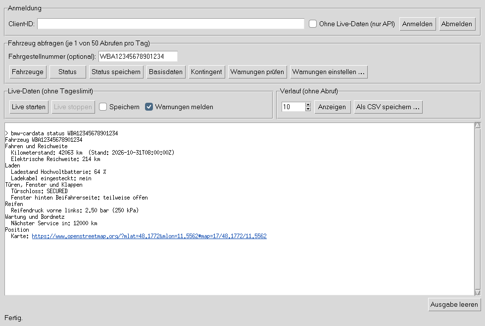
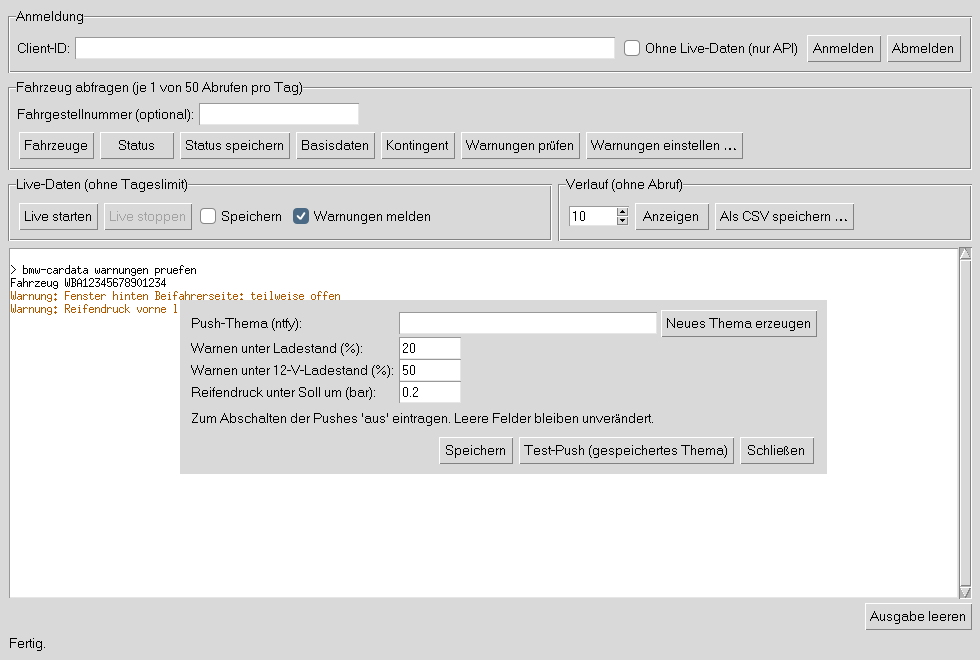

# bmw-cardata

Kommandozeilen-Client für die **offizielle BMW CarData API**. Er liest rund 40 Werte
deines BMW oder MINI, gruppiert nach Fahren und Reichweite, Laden, Türen/Fenster/Klappen,
Reifen, Wartung und Position, auf Wunsch auch live über den Datenstrom von BMW
(`bmw-cardata live`).

## Warum nicht bimmer_connected?

`bimmer_connected` (und damit auch das ältere `BMW-i-Remote` in diesem Repo)
funktioniert seit dem 29. September 2025 nicht mehr: BMW sperrt seitdem
Drittanbieter-Zugriffe auf die My-BMW-Schnittstelle. Der offizielle Ersatz ist
BMW CarData.

## Was geht und was nicht

- **Nur lesen.** CarData kennt keine Befehle: kein Verriegeln, kein Hupen, keine
  Klimatisierung, kein Ladestart.
- **Nur EU-Konten.** Das CarData-Portal gibt es nicht in jedem Land.
- **50 Abrufe pro Tag** pro Konto. `fahrzeuge` und `basisdaten` kosten je 1 Abruf, `status`
  1 Abruf, einmal am Tag 1 weiteren für die Wartungsdaten. Nur beim allerersten `status` ohne Fahrgestellnummer kommt 1 Abruf für die
  Fahrzeugliste dazu (danach ist das Fahrzeug gemerkt) und einmalig 1 bis 2 Abrufe für den
  Datencontainer. `verlauf` und `kontingent` kosten nichts. Ist das Limit erreicht, meldet BMW
  HTTP 429, der Client zeigt dann „Tageslimit erreicht“. `live` nutzt den Datenstrom und
  zählt nicht gegen dieses Limit.
- Werte kommen nur, wenn das Auto Daten gesendet hat. Fehlen Werte, kurz die
  My-BMW-App öffnen oder ein Stück fahren.

## Einrichtung im BMW-Portal (einmalig)

1. Bei <https://www.bmw.de/de-de/mybmw/vehicle-overview> anmelden
   (MINI: <https://www.mini.de/de-de/mymini/vehicle-overview>).
2. Fahrzeug wählen, dann **BMW CarData**.
3. Unter **CARDATA API** eine **Client-ID** erzeugen und kopieren
   (Anleitung von BMW: <https://bmw-cardata.bmwgroup.com/customer/public/api-documentation/Id-Technical-registration_Step-1>).
   Den Knopf „Gerät authentifizieren“ im Portal **nicht** drücken, das übernimmt der Client.
4. **„Zugriff auf CarData API anfordern“** klicken und etwa eine Minute warten,
   bis BMW die Freigabe verteilt hat. Sonst gibt es HTTP 403.
5. Für Live-Daten zusätzlich den Zugriff auf **CarData Stream** anfordern (englisch:
   „Request access to CarData Stream“) und wieder etwa eine Minute warten.
6. Unter **CARDATA STREAMING** den Datenstrom konfigurieren (englisch: „Configure data
   stream“): alle Datenpunkte laden („Load more“) und die gewünschten anhaken. Nur
   angehakte Datenpunkte schickt das Auto.

Ohne Schritt 5 und 6 funktioniert alles außer `live`; dann mit `anmelden --nur-api` anmelden.

## Windows-App



Für Windows gibt es eine App mit Fenster (`BMW-CarData.exe`) und die Kommandozeile
(`bmw-cardata-cli.exe`), beide ohne Installation lauffähig. Die App bietet alle Funktionen per
Knopfdruck: Anmelden (der Link zur Bestätigung ist anklickbar), Fahrzeuge, Status,
Basisdaten, Kontingent, Warnungen prüfen und einstellen, Live-Daten starten und stoppen
(mit Warnungen) sowie den Verlauf anzeigen oder als CSV für Excel speichern. Sie nutzt intern genau dieselben Befehle wie die Kommandozeile.

**Herunterladen:** Der Workflow „bmw-cardata Windows“ (GitHub → Actions) testet bei jeder
Änderung alles unter Windows, baut beide Programme und hängt sie als Artefakt
`bmw-cardata-windows` an den Lauf. Windows warnt beim ersten Start, weil die Programme
nicht signiert sind („Weitere Informationen“ → „Trotzdem ausführen“). Mehr in
[`windows/LIESMICH.txt`](windows/LIESMICH.txt).

Aus dem Quellcode startet die App mit `bmw-cardata-app` (nach `pip install .`).

## Installation

```bash
cd bmw-cardata
python3 -m pip install .
```

Python 3.10 oder neuer.

## Benutzung

```bash
export BMW_CARDATA_CLIENT_ID="deine-client-id"
bmw-cardata anmelden          # Link öffnen, Code eingeben, bei BMW bestätigen
bmw-cardata fahrzeuge         # Fahrgestellnummern
bmw-cardata status            # Status deines einzigen Fahrzeugs
bmw-cardata status WBA…       # Status eines bestimmten Fahrzeugs
bmw-cardata status --speichern  # Status zeigen und im lokalen Verlauf ablegen
bmw-cardata status --json     # Status als JSON, z. B. für eigene Skripte
bmw-cardata basisdaten WBA…   # Basisdaten, so wie BMW sie liefert
bmw-cardata verlauf           # die letzten 10 gespeicherten Abrufe (--anzahl N für mehr)
bmw-cardata verlauf --csv > fahrten.csv   # alle Einträge für Excel/LibreOffice
bmw-cardata kontingent        # eigene Abrufe der letzten 24 Stunden
bmw-cardata live              # Live-Daten empfangen, bis Strg+C
bmw-cardata live --warnungen  # dabei neue Warnungen melden und pushen
bmw-cardata warnungen pruefen # Status abrufen und neue Warnungen melden (1 Abruf)
bmw-cardata warnungen einstellen --ntfy-thema neu   # Push aufs Handy einrichten
bmw-cardata abmelden          # gespeicherte Anmeldung löschen
```

Beispielausgabe (gekürzt):

```
Fahrzeug WBA12345678901234
Fahren und Reichweite
  Kilometerstand: 42063 km  (Stand: 2026-10-30T10:00:00Z)
  Elektrische Reichweite: 214 km
Laden
  Ladestand Hochvoltbatterie: 64 %
Türen, Fenster und Klappen
  Türschloss: SECURED
  Fenster hinten Beifahrerseite: teilweise offen
Reifen
  Reifendruck vorne links: 2.50 bar (250 kPa)
Wartung und Bordnetz
  Nächste Hauptuntersuchung: 2027-05
```

### Welche Werte

| Gruppe | Werte |
|---|---|
| Fahren und Reichweite | Kilometerstand, Gesamt-, elektrische und Kraftstoffreichweite, Tankfüllstand, Restkraftstoff, in Bewegung |
| Laden | Ladestand, Ladeziel, Ladestatus, Restladezeit, Ladeleistung, Kabel eingesteckt, Ladeklappe offen, Batteriegesundheit |
| Türen, Fenster und Klappen | Türschloss, Türen gesamt und einzeln, vier Fenster, Heckklappe offen/verriegelt, Motorhaube, Schiebedach, Licht, Alarmanlage |
| Reifen | Reifendruck an allen vier Rädern, Reifendiagnose |
| Wartung und Bordnetz | 12-V-Batterie (Ladung und Spannung), nächster Service, nächste Hauptuntersuchung |
| Position | Breiten- und Längengrad, Kartenlink |

Was ein Auto wirklich liefert, hängt von Modell und Ausstattung ab; fehlende Werte werden
nicht angezeigt. Fenster und Schiebedach werden übersetzt (geschlossen, teilweise offen,
offen, ungültig), Ja/Nein-Werte ebenso; andere Textwerte wie beim Türschloss zeigt der
Client so, wie BMW sie liefert. Den Reifendruck liefert BMW in kPa, angezeigt wird er
zusätzlich in bar. Eine Außentemperatur gibt es in CarData nicht.

Hat BMW eine Position geliefert, steht am Ende ein Link zu OpenStreetMap
(`Karte: https://www.openstreetmap.org/?mlat=…`).

### Fahrzeug merken

Hat dein Konto genau ein Fahrzeug, merkt sich der Client dessen Fahrgestellnummer beim
ersten `status` und spart danach den Abruf der Fahrzeugliste. `fahrzeuge` frischt die
gemerkte Nummer auf (bei mehreren Fahrzeugen wird keine gemerkt). Lehnt BMW das gemerkte
Fahrzeug ab (z. B. nach einem Verkauf), vergisst der Client die Nummer, holt einmal die
aktuelle Fahrzeugliste und versucht es damit erneut.

### Verlauf

`status --speichern` hängt jeden Abruf an `verlauf.jsonl` an (im selben Ordner wie die
Anmeldung, Rechte 600, da die Position enthalten sein kann). `verlauf` zeigt die Einträge
mit den seit dem Eintrag davor gefahrenen Kilometern:

```
30.10.2026 17:30  Kilometerstand: 42000 km, Ladestand Hochvoltbatterie: 64 %  (+120 km)
31.10.2026 08:00  Kilometerstand: 42063 km, Ladestand Hochvoltbatterie: 51 %  (+63 km)
```

`verlauf --csv` gibt alle Einträge mit Semikolon getrennt aus, so öffnet ein deutsches
Excel sie direkt in Spalten. `abmelden` löscht den Verlauf nicht (es weist aber darauf hin);
zum Löschen die Datei `verlauf.jsonl` entfernen.

Für einen regelmäßigen Verlauf eignet sich ein Cron-Eintrag, z. B. zweimal am Tag
(`crontab -e`; den vollen Pfad liefert `command -v bmw-cardata`):

```
0 7,19 * * * /voller/pfad/zu/bmw-cardata status --speichern >/dev/null
```

### Live-Daten

`live` verbindet sich mit dem Datenstrom von BMW (MQTT über TLS,
`customer.streaming-cardata.bmwgroup.com:9000`) und zeigt jede Nachricht vom Auto sofort an:

```
Fahrzeug WBA12345678901234
15:12:04  Kilometerstand: 42063 km
15:12:04  Ladestand Hochvoltbatterie: 51 %
```

- Das Auto sendet, wenn sich etwas ändert: beim Fahren, Laden, Ver- und Entriegeln. Steht
  es still, kann es lange ruhig bleiben.
- `live WBA…` zeigt nur ein Fahrzeug, `--json` gibt eine JSON-Zeile pro Nachricht aus,
  `--speichern` legt jede Nachricht im Verlauf ab.
- Der Zugang wird vor dem Ablauf automatisch erneuert, nach einem Abbruch verbindet sich
  der Client von selbst neu (nach 5, 10, 30, dann alle 60 Sekunden). Lehnt BMW kurz ab,
  versucht er es nach 3 Sekunden erneut; erst die dritte Ablehnung in Folge beendet `live`
  mit einer Erklärung.
- **Nur eine Verbindung pro Konto:** Läuft schon Home Assistant oder ein anderes Programm
  mit dem Datenstrom, lehnt BMW `live` ab oder wirft es immer wieder hinaus. Dann beendet
  sich `live` mit einem Hinweis, statt den anderen Stream dauerhaft zu stören.
- BMWs Server verlangt **TLS 1.3**; dafür braucht Python OpenSSL 1.1.1 oder neuer (bei
  aktuellen Python-Versionen der Fall).
- Wer sich vor dieser Version angemeldet hat, muss sich für `live` einmal neu anmelden,
  damit BMW die Berechtigung `cardata:streaming:read` erteilt.

### Warnungen



bmw-cardata meldet, wenn am Auto etwas auffällt:

| Warnung | Wann |
|---|---|
| Tür, Heckklappe, Motorhaube offen | BMW meldet sie als offen |
| Fenster, Schiebedach offen | Wert `OPEN` oder `INTERMEDIATE` (teilweise offen) |
| Nicht verriegelt | Türschloss meldet einen anderen Wert als die eingestellten (Standard `LOCKED`, `SECURED`) |
| Ladestand niedrig | unter 20 % (einstellbar) |
| 12-V-Batterie schwach | unter 50 % (einstellbar) |
| Reifendruck | ein Reifen 0,2 bar oder mehr unter seinem Solldruck (einstellbar) |
| Laden beendet | Ladestatus wechselt von „lädt“ zu etwas anderem |

Jede Warnung meldet sich einmal, wenn sie auftritt, nicht bei jedem Abruf. Ist sie behoben
und tritt wieder auf, meldet sie sich erneut. Kommt ein Push nicht an (z. B. kein Netz), wird
er beim nächsten Mal wiederholt. Werte wie `INVALID` gelten weder als Alarm noch als
Entwarnung, und eine Ladepause zählt nicht als „Laden beendet“. `status` zeigt alle gerade
geltenden Warnungen.

- **Sofort:** `bmw-cardata live --warnungen` (in der App: „Warnungen melden“ beim Live-Start).
- **Nach Zeitplan:** `bmw-cardata warnungen pruefen` (1 Abruf), z. B. per Cron oder
  Windows-Aufgabenplanung alle zwei Stunden.

**Push aufs Handy** über [ntfy](https://ntfy.sh) (kostenlose App für Android und iOS):

```bash
bmw-cardata warnungen einstellen --ntfy-thema neu   # erzeugt ein zufälliges Thema
bmw-cardata warnungen test                          # Test-Push
```

Das angezeigte Thema in der ntfy-App abonnieren. Wer das Thema kennt, kann die Pushes
mitlesen, deshalb ist es zufällig und lang; nicht weitergeben. Die Pushes enthalten nur die
Warnung und die letzten vier Zeichen der Fahrgestellnummer, nie die Position. Eigener
ntfy-Server: `--ntfy-server https://…`; abschalten: `--ntfy-thema aus`.

Grenzwerte: `warnungen einstellen --ladestand 25 --batterie-12v 40 --reifendruck-toleranz 0.3`.
Meldet dein Türschloss einen anderen Wert für „verriegelt“ (`status` zeigt ihn), z. B.
`--verriegelt LOCKED,SECURED,SELECTIVE_LOCKED`. Den Wertebereich des Türschlosses
dokumentiert BMW nicht; die Warnung nennt deshalb immer den Originalwert.

Den Solldruck der Reifen liefert BMW als eigenen Datenpunkt; ohne ihn gibt es keine
Reifendruck-Warnung. Einstellungen liegen in `warnungen.json`, der letzte Stand in
`warnungen-zustand.json` (beide neben der Anmeldung).

### Kontingent

`kontingent` zählt die Abrufe dieses Programms in den letzten 24 Stunden und sagt, wie
viele der 50 noch frei sind. Ist alles verbraucht, nennt es den Zeitpunkt, ab dem der
älteste Abruf aus dem 24-Stunden-Fenster fällt. Zwei Einschränkungen: Abrufe anderer
Programme mit derselben Client-ID (z. B. Home Assistant) zählt es nicht mit, und wann
BMW den Zähler genau zurücksetzt, ist hier nicht bekannt. Die Anzeige ist also eine
Schätzung von unten.

Die Anmeldung (Client-ID, Tokens, ID des Datencontainers, gemerkte Fahrgestellnummer)
liegt in `~/.config/bmw-cardata/state.json`, nur für dich lesbar (Rechte 600). Daneben
liegen `abrufe.json` (Abrufzähler) und, falls genutzt, `verlauf.jsonl`. Anderer Ort:
`--state PFAD` oder Umgebungsvariable `BMW_CARDATA_STATE`. Abgelaufene Zugangstokens
werden automatisch erneuert; lehnt BMW die Erneuerung ab, einfach neu `anmelden`.

## Datencontainer

Für Telematikdaten verlangt BMW einen „Container“, der festlegt, welche Datenpunkte
geliefert werden. Der Client nutzt zwei:

- `bmw-cardata-cli Status` mit allen Werten außer den Wartungsdaten, bei jedem `status`.
- `bmw-cardata-cli Wartung` mit nächstem Service und Hauptuntersuchung, höchstens einmal am
  Tag je Fahrzeug; die Werte liegen dazwischen in `wartung.json`. Die Home-Assistant-
  Integration hat diese Datenpunkte getrennt, nachdem sie am 20.10.2026 jeden Abruf ihres
  Containers mit `CU-400` scheitern ließen. Ein solcher Fehler kostet hier nur die zwei
  Wartungswerte (Hinweis in der Ausgabe, neuer Versuch am nächsten Tag).

Der Client merkt sich jeden Container mit einem Fingerabdruck der Datenpunkte. Ändern sie
sich (etwa nach einem Update), legt er einmalig einen neuen an und löscht danach den alten,
den er selbst gespeichert hatte; das kostet einmal etwa 3 Abrufe. Container anderer
Installationen mit gleichem Namen bleiben unberührt. Lehnt BMW den neuen Container ab,
bleibt der alte in Gebrauch, und erst am nächsten Tag folgt ein neuer Versuch.

Meldet BMW einen Container als gelöscht (HTTP 404 oder `CU-105`), wird er einmal neu
angelegt. Andere Fehler wie HTTP 400 legen keinen neuen an, weil das jedes Mal Abrufe
kosten würde. Welche Datenpunkte abgefragt werden, steht in `src/bmw_cardata/descriptors.py`.

## Tests

```bash
python3 -m pip install -e '.[dev]'
python3 -m pytest
```

Die Tests laufen gegen einen simulierten BMW-Server, ohne Netzwerkzugriff.

## Herkunft der API-Details

Adressen, Anmeldeablauf und Antwortformate stammen aus der öffentlichen
BMW-CarData-Dokumentation und der Home-Assistant-Integration
[kvanbiesen/bmw-cardata-ha](https://github.com/kvanbiesen/bmw-cardata-ha). Der Code
hier ist eigenständig geschrieben.
